# kubedeck

A fast, native desktop client for Kubernetes: **Tauri 2 + Rust** (`kube-rs`) on the backend and **React + TypeScript** for the interface.

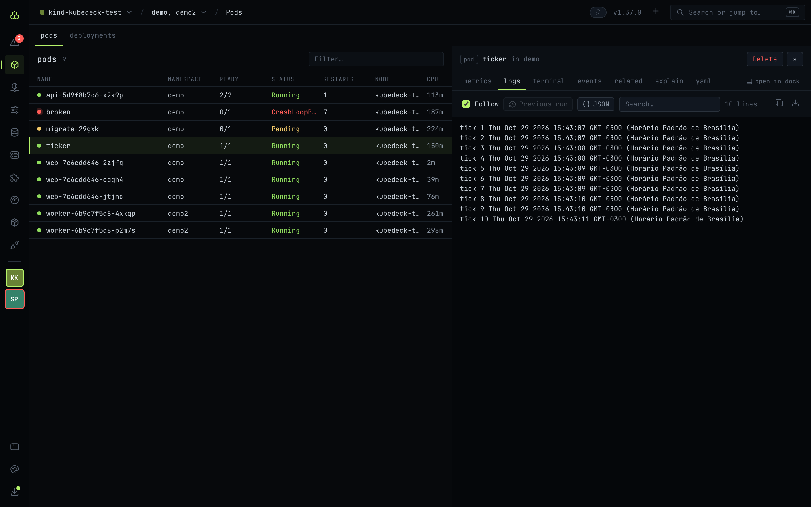

## Screens

| | |
|---|---|
| 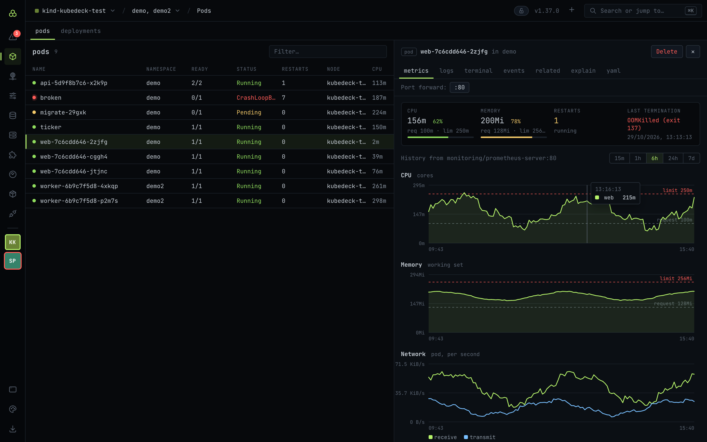 | 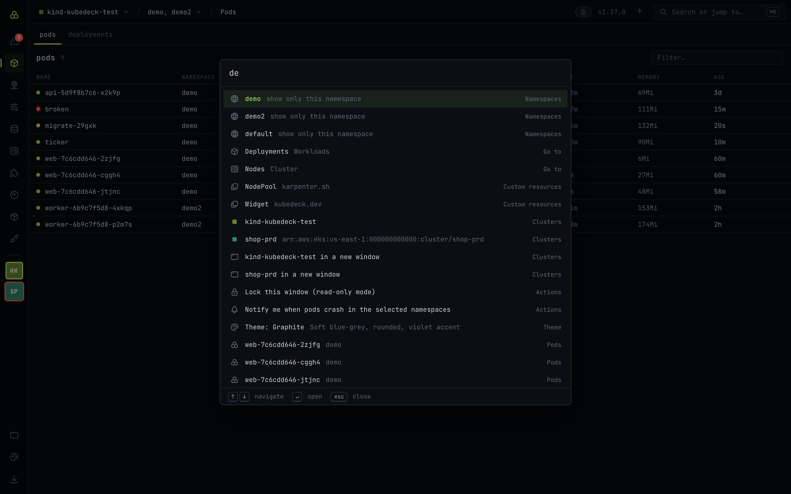 |
| **Pod metrics:** CPU and memory against requests and limits, restarts, last termination (OOMKilled highlighted) and Prometheus history with network and throttling. | **Command palette (⌘K):** fuzzy search across kinds, CRDs, resources, clusters, namespaces, themes and actions. |
| 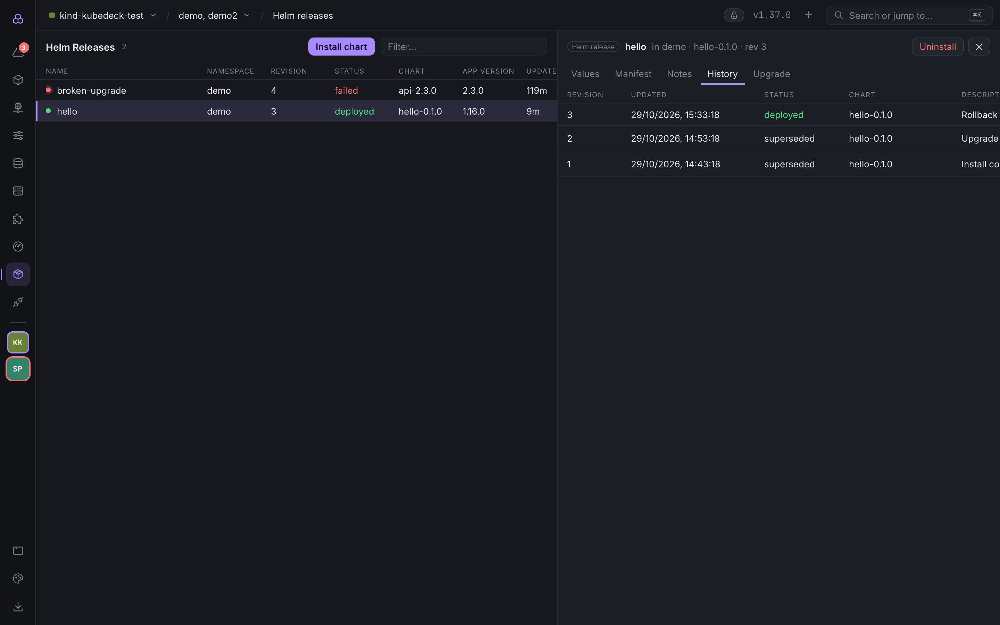 | 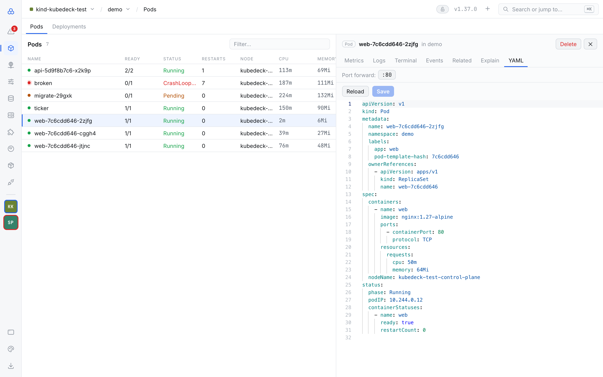 |
| **Helm, Graphite theme:** releases, history with rollback, upgrades and chart installs. | **YAML, Light theme:** Monaco editing that never overwrites someone else's change, plus per-port port forwarding. |
| 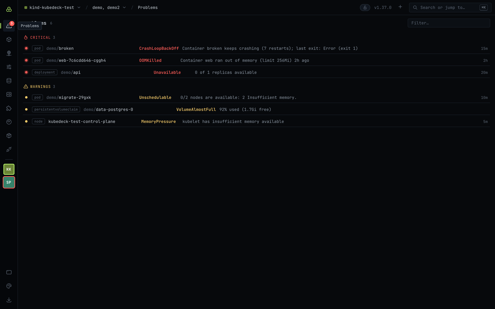 | 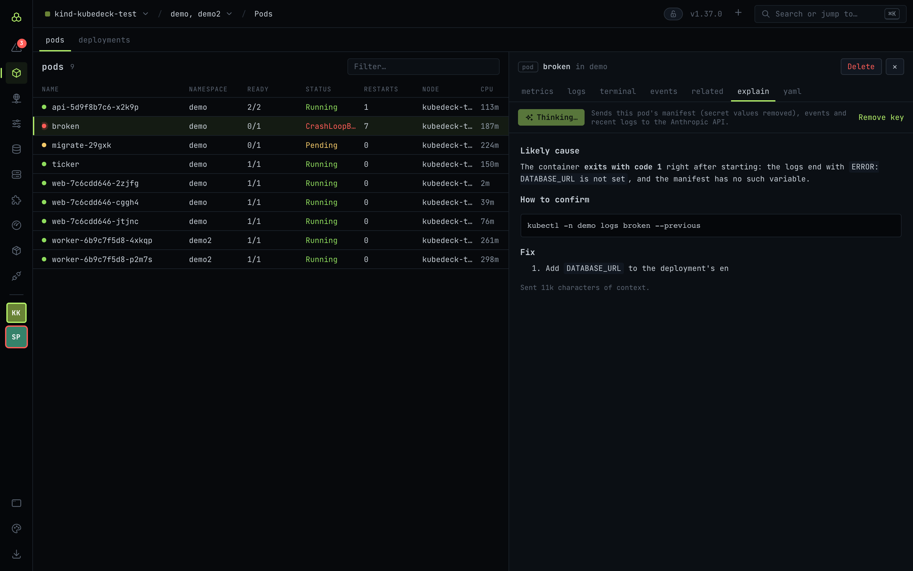 |
| **Problems:** everything that looks wrong in the selected namespaces, worst first; one click opens the object. | **Explain with Claude:** Claude reads the manifest (secrets removed), events and logs, then suggests the cause and a fix. |
| 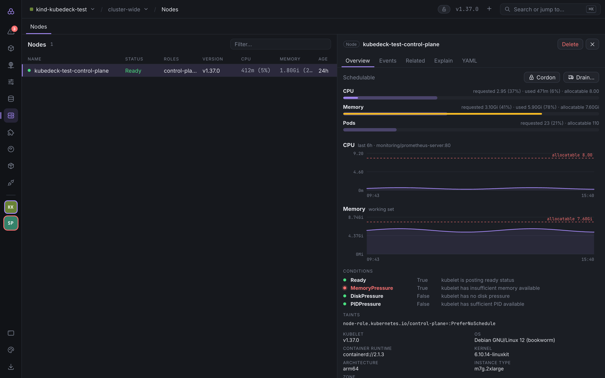 | 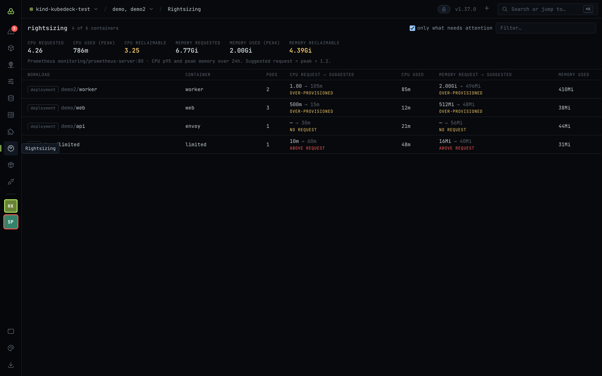 |
| **Nodes:** capacity against requests and real usage, history, conditions, taints, cordon and drain with a preview. | **Rightsizing:** each container's requests against real usage, with a suggestion and how much can be reclaimed. |
| 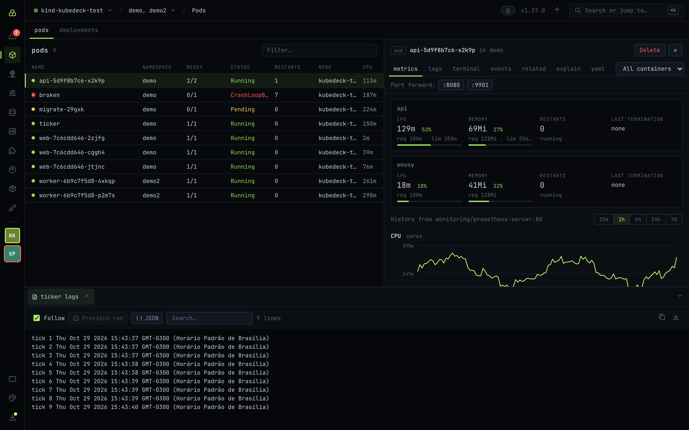 | 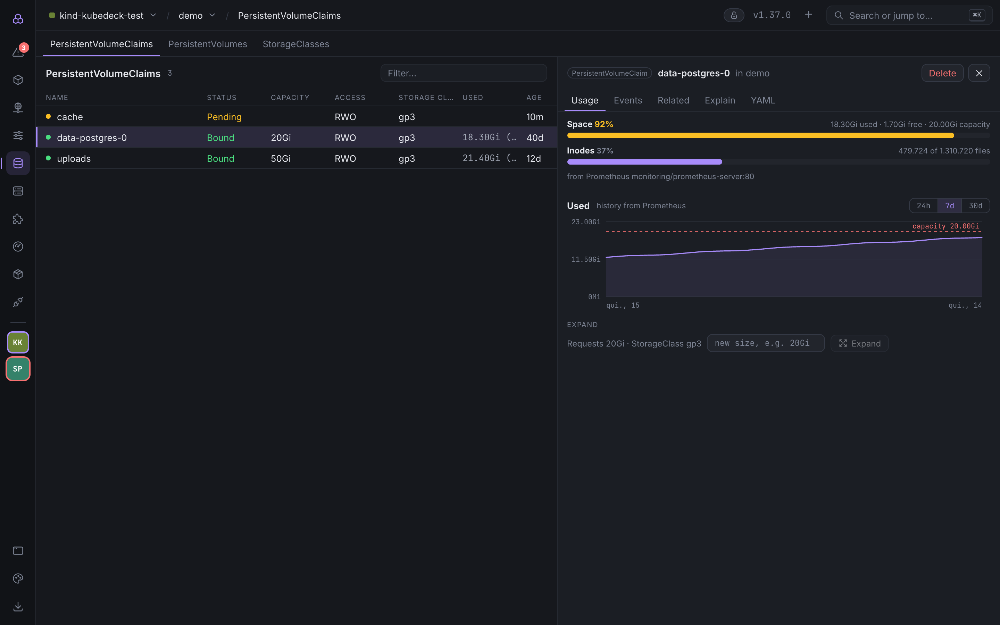 |
| **Dock:** terminals and logs that stay open while you browse. | **Storage:** how full each volume is, its history, and expansion. |
| 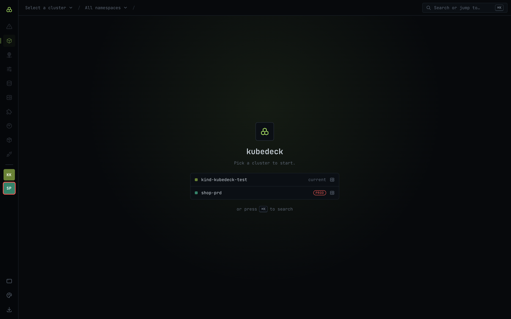 | |
| **Welcome:** pinned clusters first, production flagged. | |

The images use the sample data of the browser-only UI. To redo them after changing the interface, run `npm run dev` and, in another terminal, `npm run screenshots` (it drives the Google Chrome installed on your machine).

## Install

macOS and Linux:

```bash
curl -fsSL https://raw.githubusercontent.com/cardoso010/kubedeck/main/scripts/install.sh | bash
```

Windows (PowerShell):

```powershell
irm https://raw.githubusercontent.com/cardoso010/kubedeck/main/scripts/install.ps1 | iex
```

On a Mac the script downloads the right build (Apple Silicon or Intel) and installs it in `/Applications`. On Linux it installs the AppImage in `~/.local/bin` with an applications-menu entry (AppImages need FUSE 2, `libfuse2`). On Windows it runs the installer silently. Each [release](https://github.com/cardoso010/kubedeck/releases) also has `.dmg` and `.deb` files for manual installs.

After that, the app tells you when a new version is out and updates itself in one click (**Install and restart**, at the bottom of the sidebar). Updates are signed, and the app refuses packages without a valid signature. If `GITHUB_TOKEN`/`GH_TOKEN` is set or the GitHub CLI is logged in, the update check uses that token, which avoids GitHub's anonymous rate limit and makes updates work from a private fork (`KUBEDECK_UPDATE_REPO=owner/name`).

The app is not signed with an Apple Developer ID or notarized yet. The install script takes care of Gatekeeper; if you install from the `.dmg`, allow the app once in **System Settings → Privacy & Security**.

## Features

- **Its own look, with themes.** *Terminal* (default: near-black, monospace, lime accent), *Graphite* (blue-gray, rounded corners, violet accent) and *Light*. The YAML editor and the terminal follow the theme, and the choice applies to every window (palette icon in the rail, or ⌘K → "Theme").
- **A lean layout.** A thin rail on the left with the sections (Problems, Workloads, Network, Config, Storage, Cluster, Custom resources, Rightsizing, Helm, Port forwards) and your pinned clusters; a `cluster / namespaces / kind` breadcrumb; tabs with the section's kinds; details in a drawer on the right.
- **Command palette (⌘K / Ctrl+K)** with fuzzy search: jump to any kind (CRDs included) or resource in the table, switch cluster or open one in a new window, pick namespaces, change the theme, or run actions such as installing a chart.
- Reads `~/.kube/config` (or `$KUBECONFIG`) and connects to any context, including EKS/GKE through exec plugins. The app inherits your login shell's `PATH`, so `aws`/`gcloud` are found even when it is opened from the Finder.
- **Several windows**: each window is independent (its own cluster, watches, terminals and port forwards), so two clusters can sit side by side. Pinned clusters (pin icon in the cluster picker) live in the rail: click switches this window's cluster, ⌘/Ctrl-click (or right-click) opens a new window, ⌘/Ctrl+1…9 switches between them and ⌘/Ctrl+N opens an empty window. Production clusters get a red ring.
- **Several namespaces at once**: the namespace picker allows multiple selection (click a name to select only it; the checkbox adds it), remembered per cluster. Pods, metrics and Helm releases follow the selection, and a Namespace column appears when there is more than one.
- Live lists (*watch*) of Pods, Deployments, StatefulSets, DaemonSets, Jobs, CronJobs, Services, Ingresses, ConfigMaps, Secrets, PersistentVolumeClaims, PersistentVolumes, StorageClasses, Events, Nodes and Namespaces, with a filter and a virtualized table.
- **Custom Resources:** on connect, the app reads the cluster's CRDs and lists them in the sidebar, grouped by API group and searchable. Columns are the same as `kubectl get` (`additionalPrinterColumns`).
- **Metrics:** CPU and memory columns for Pods and Nodes (with the share of the node's *allocatable*) when the cluster has metrics-server. Without it, the columns simply don't show.
- **Pod Metrics tab** (the first in the drawer): per container, current CPU and memory against requests and limits, restarts, state and why it last stopped (OOMKilled in red). If the cluster has **Prometheus**, it shows history (15 min to 7 days) of CPU, memory, network and CPU *throttling*, with the request and limit lines. The app finds Prometheus by its usual service names and queries it through the API server proxy with your own credentials: no port forward and no configuration. To point at another one, set `KUBEDECK_PROMETHEUS=namespace/service:port`. Without Prometheus, CPU and memory charts are live (every 10 s) from when the tab opens.
- **Details drawer:**
  - **YAML** in Monaco, saved with `replace`. The `resourceVersion` stops you from overwriting someone else's change, and a **diff** shows exactly what changes before saving.
  - **Logs** streamed with follow and filter.
  - **Terminal** (exec with TTY and resize) in the chosen container.
  - **Delete**.
  - **Port forward** for pods and services: each TCP port is a button. A service picks a ready pod on every connection, so it keeps working when pods are replaced. The **Port Forwards** screen lists active tunnels with their connection count and last error.
- **Workloads:** restart, scale and pause/resume Deployments, StatefulSets and DaemonSets; a **Rollout** tab with revision history, diffs between revisions and rollback; an **Events** tab for every object.
- **Better logs:** the previous run (`--previous`), the merged logs of every pod in a workload, JSON mode, search with highlighting, copy and save to a file.
- **Problems** (first icon in the rail, with a count of critical ones): crash loops, OOMKilled, images that won't pull, pending or unready pods, unavailable workloads, failed jobs, pending PVCs, volumes almost full, failed PVs and unhealthy nodes.
- **Related:** each object's owner, pods, services, ingresses, ConfigMaps/Secrets/volumes it uses and the node it runs on, all clickable.
- **Nodes:** an overview with capacity, requests and usage, Prometheus history, conditions and taints; **cordon/uncordon** and **drain** with a preview of what will be evicted (PodDisruptionBudgets are respected; DaemonSet and static pods are skipped).
- **Storage** (its own rail section): PersistentVolumeClaims with a **Used** column, PersistentVolumes and StorageClasses. A PVC's **Usage** tab shows space and inodes used, history (24 h to 30 days, from Prometheus) and lets you **expand** the volume when its StorageClass allows it. Usage comes from Prometheus (`kubelet_volume_stats_*`) or, without it, straight from the kubelets; only volumes that measure themselves (CSI drivers such as EBS, `local` volumes) report usage. Volumes above 85% show up in Problems (critical above 95%).
- **Explain with Claude:** only when you click. It sends the manifest (env values and the `last-applied` annotation removed), the events and, for pods, recent logs to the Anthropic API; Secrets are never sent. The API key is kept in the system keychain (or read from `ANTHROPIC_API_KEY`).
- **Read-only mode per cluster:** production clusters open locked (the backend refuses every write, terminals included). The lock in the top bar unlocks for 15 minutes; ⌘K → "Always open this cluster read-only" changes each cluster's default.
- **Hidden Secrets:** a Secret's YAML comes masked until you click **Reveal values**; the **Data** tab reveals or copies one key at a time, with a confirmation on production.
- **Log in from the app:** when credentials expire, the banner has a field with the login command (`aws sso login --profile …` by default, editable and remembered per cluster) and a **Run login** button that runs it and reconnects.
- **Expired credentials:** if the cluster rejects your credentials (401, for example when the AWS session behind `aws eks get-token` ends), a banner explains what to renew (the kubeconfig's command and AWS profile) and the app reconnects by itself every 20 s. As soon as the credentials work again, the window recovers without reopening.
- **Dock:** "open in dock" on the logs and terminal tabs moves the session to tabs at the bottom, which keep running while you browse.
- **Starred port forwards:** the star on a Port Forwards row reopens that tunnel whenever the cluster is connected.
- **Create from YAML** (`+` button or ⌘K): paste one or more documents, validate with a server-side dry run, then create.
- **Notifications:** ⌘K → "Notify me when pods crash…" sends a system notification when a crash loop, OOMKilled or image error appears in the selected namespaces.
- **Rightsizing:** each container's requests and limits against real usage (CPU p95 and peak memory over 24 h from Prometheus, or current usage from metrics-server), with the suggested request and how much can be reclaimed in total.
- **Helm Releases:** lists releases and shows values, manifest, notes and history, with **rollback** to an earlier revision and **uninstall**. **Install chart** searches your configured repositories (the same as `helm repo list`, which can be managed there), picks a version and opens the chart's default values for editing; each release's **Upgrade** tab starts from its current values. Both have a *dry run* (renders and validates on the server without changing anything) and the production confirmation. The app ships its own Helm (3.22.1) as a sidecar, so it works with nothing installed. It always uses the app's kubeconfig and context. To use another binary, set `KUBEDECK_HELM` to its path.
- **Production safety:** contexts with `prd`/`prod`/`production` in their name show a red strip, open read-only, and saving, deleting, scaling, draining, installing, upgrading, rolling back or uninstalling on them requires typing the object's name.

## Develop

```bash
npm install
npm run tauri dev        # native app with hot reload
npm run tauri build      # builds src-tauri/target/release/bundle/macos/kubedeck.app
npm run dev              # the interface alone, in a browser, with sample data (src/dev-mock.ts)
npm run screenshots      # with npm run dev running: redoes the images in docs/screenshots
```

Before `dev` and `build`, `npm run binaries` downloads Helm into `src-tauri/binaries/` (not in git) and checks the SHA-256 pinned in `scripts/fetch-helm.mjs`. To use `cargo` directly (`cargo check`, `cargo test`), run `npm run binaries` once first. To update Helm, change the version and hashes in that script, copying them from the release notes on GitHub.

Code conventions and the precautions for working on the project (including with Claude Code) are in [CLAUDE.md](CLAUDE.md).

## Testing

The end-to-end tests run against a **disposable kind cluster**. They edit a ConfigMap, delete a pod, and roll back and uninstall Helm releases, so never point them at a shared cluster. The script creates the cluster with every fixture (workloads in two namespaces, a pod with requests and limits, a volume that reports usage, a Helm release, a sample CRD, metrics-server, a minimal Prometheus, and a second context that authenticates through an exec plugin, to test revoked credentials) in a separate kubeconfig, `.kind-kubeconfig`, without touching `~/.kube/config`:

```bash
npm run binaries
e2e/setup.sh                    # creates or completes the cluster; e2e/setup.sh --delete removes it
cd src-tauri
KUBECONFIG=$PWD/../.kind-kubeconfig KUBEDECK_E2E_CONTEXT=kind-kubedeck-test \
  KUBEDECK_HELM=$PWD/binaries/helm-$(rustc -vV | sed -n 's/host: //p') \
  cargo test -- --include-ignored
```

CI (`.github/workflows/ci.yml`) runs the typecheck, clippy, unit tests and this same end-to-end suite on a kind cluster inside the runner, on every push and pull request.

## Release

```bash
npm run release -- 0.5.0 --push
```

The script checks that the tree is clean and on `main`. It then bumps the version in `package.json`, `tauri.conf.json`, `Cargo.toml` and `Cargo.lock`, commits, tags `v0.5.0` and pushes. The tag starts the **Release** workflow, which:

1. creates a draft release with notes generated from the commits;
2. builds the app for macOS (Apple Silicon and Intel, with `.dmg`), Linux (AppImage and `.deb`) and Windows (NSIS installer), each with its signed update package;
3. writes the `latest.json` the updater reads (`scripts/latest-json.mjs`) and publishes the release.

Installed apps find the new version on their next check, at startup and then every 6 hours.

To check packaging without publishing anything, run the workflow by hand (**Actions → Release → Run workflow**): it only builds the four platforms and keeps the files as run artifacts for 7 days.

Update packages are signed with a key kept in the repository secrets (`TAURI_SIGNING_PRIVATE_KEY` and `TAURI_SIGNING_PRIVATE_KEY_PASSWORD`); installed apps only accept updates signed with it. Forks that publish their own builds need their own key pair and `pubkey` in `tauri.conf.json`.

## Architecture

```
src-tauri/src/
  cluster.rs      kubeconfig contexts, connecting (also reads the CRDs), namespaces, read-only mode, login command
  kinds.rs        built-in and CRD kinds, each object summarized as a table row, JSONPath
  resources.rs    generic watch (DynamicObject), get/replace YAML, delete, create from YAML
  streams.rs      logs and interactive exec
  portforward.rs  port forwards for pods and services (one stream per TCP connection)
  workloads.rs    restart, scale, pause, rollout history and rollback, object events
  diagnostics.rs  the Problems scan and the Related graph
  nodes.rs        node overview, cordon, drain
  storage.rs      volume usage and history, expanding claims
  rightsizing.rs  requests against real usage per container
  secrets.rs      masked Secrets and per-key reveal
  ai.rs           Explain with Claude
  helm.rs         releases through the bundled Helm
  helm_charts.rs  repositories, chart search, install and upgrade
  metrics.rs      CPU and memory from metrics-server
  pod_insights.rs a pod's metrics: usage against requests/limits, Prometheus history
  updater.rs      self-update from GitHub releases
  windows.rs      new windows, saving files
  state.rs        one session per window: connection and active streams (by id)
src/
  api.ts          typed wrappers for the Rust commands
  App.tsx         layout, cluster/namespace/kind selection, watch state, palette commands
  App.css         theme tokens ([data-theme]) and all styling
  theme.ts        themes, editor and terminal colors
  sections.ts     rail sections
  components/     rail, top bar, tabs, ⌘K palette, table, details drawer, dock, Helm, port forwards, …
scripts/          fetch-helm, release, latest-json, install (sh and ps1), screenshots
docs/screenshots/ README images
e2e/              kind cluster and fixtures for the end-to-end tests
```

Watch events, logs and terminal output flow from Rust to the interface over `tauri::ipc::Channel`. Each stream has an id and ends with `stop_stream`, which the interface calls when it leaves a screen.

## Roadmap

- Apple Developer ID signing and notarization, so the `.dmg` installs without a Gatekeeper warning
- Linux arm64 and Windows arm64 builds; Homebrew and winget packages
- A diff between the current release and the *dry run* when upgrading Helm charts
- VolumeSnapshots: list, take and restore snapshots of a claim
- Editing kubeconfig contexts from the app (rename, delete, set a default namespace)

## Contributing

Issues and pull requests are welcome. Before opening a pull request, run the typecheck, clippy and the end-to-end suite above (CI runs them too), and keep [CLAUDE.md](CLAUDE.md)'s conventions: every new command gets a typed wrapper in `src/api.ts`, a case in `src/dev-mock.ts` and end-to-end coverage, and every command that changes the cluster respects read-only mode.

## License

kubedeck is licensed under the [Apache License, Version 2.0](LICENSE). It bundles [Helm](https://helm.sh), also under the Apache License 2.0; see [NOTICE](NOTICE).
